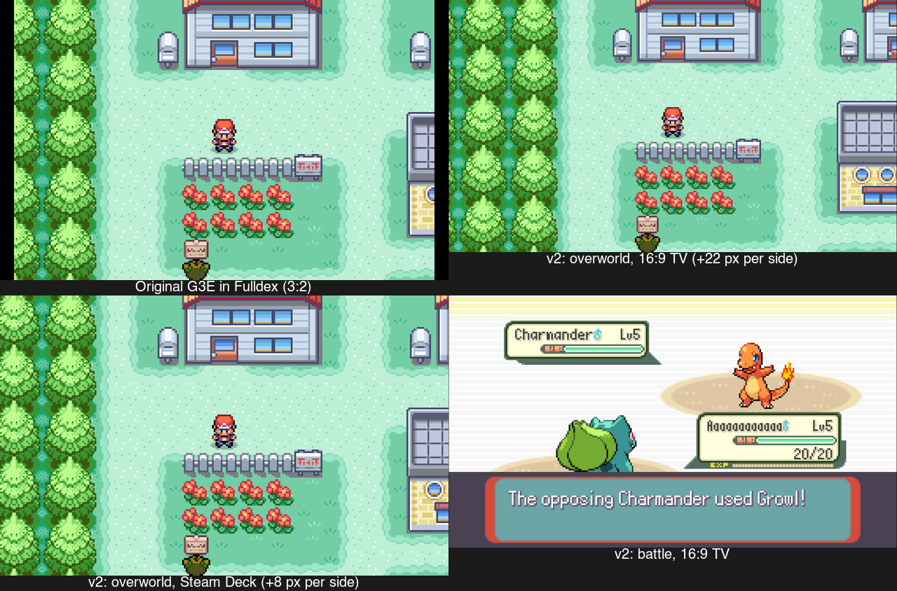

# Gen 3 Evolved widescreen for Pokémon Fulldex

Widescreen for [Generation 3 Evolved](https://github.com/specimendelta/Pokemon-Gen-3-Evolved) (G3E) in [Pokémon Fulldex](https://github.com/mamesj/pokemon-fulldex)'s GBA player.

**v2.0.0** · works with G3E v1.0.8 to v1.0.22 · no ROMs included



- Wide overworld and battles, matching FireRed's own Fulldex widescreen.
- Characters and weather fill the whole width.
- At 3:2, or in any other emulator, the game plays exactly as normal, and saves work in both.

## Use it

Patch your ROM, then play the patched file in Fulldex with ASPECT RATIO on AUTO:

```bash
python3 g3e_widescreen_v2.py "Generation 3 Evolved (v1.0.22).gba" "G3E widescreen.gba"
```

Or apply `patches/g3e-v1.0.22-widescreen-v2.bps` to v1.0.22 with any BPS patcher. Rebuilding needs `arm-none-eabi-gcc`.

Fulldex shows "NO WIDESCREEN FOR THIS ROM" at start. That's expected: the game turns widescreen on itself.

`fulldex/` holds the same patch in Fulldex's own format, [proposed for Fulldex itself](https://github.com/mamesj/pokemon-fulldex/pulls). Make it for another release with `tools/make_fulldex_patch.py ROM OUTDIR`.

## More

- [How it works](docs/HOW-IT-WORKS.md)
- [What was tested](docs/TESTING.md)
- [What's left](ROADMAP.md) · [Changelog](CHANGELOG.md)

## Credits

[Fulldex](https://github.com/mamesj/pokemon-fulldex) by mamesj, which does the widescreen drawing. [G3E](https://github.com/specimendelta/Pokemon-Gen-3-Evolved) by specimendelta. [pokeemerald-expansion](https://github.com/rh-hideout/pokeemerald-expansion) by RHH and [pret](https://github.com/pret).

GPL-3.0. Pokémon is © Nintendo / Creatures / GAME FREAK.
