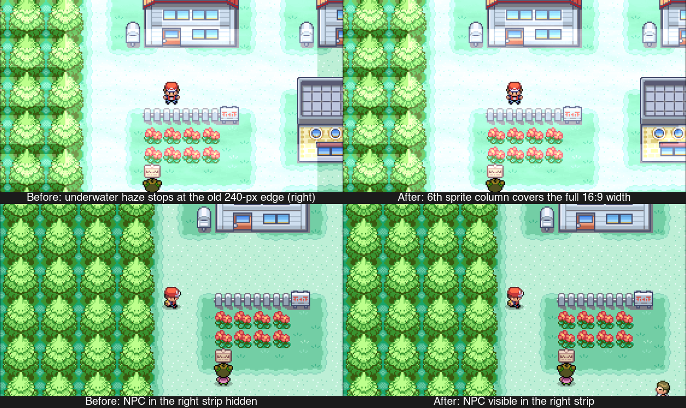

# How it works

Fulldex only draws wider than the GBA's 240 pixels when the game asks for it every frame, and the game also has to draw map data at the sides. FireRed's Fulldex patch does both. G3E is built on different code (pokeemerald-expansion), so this patch does the same things in G3E's own code.

1. **Asks for widescreen.** Small hooks on the overworld and battle screens send Fulldex's wide request every frame.
2. **Wider maps.** The map layers are doubled in width, and a new camera (`src/wide_camera.c`) fills them in as you walk.
3. **Characters.** NPCs and effects stay visible at the sides instead of disappearing at the old edge.
4. **Weather.** Fog, ash, sandstorm and underwater get an extra column of sprites. Rain lands across the full width (`src/wide_weather.c`).
5. **Map edges.** Next to a connected map, the sides show that map's terrain instead of a filler block.

The new code goes into empty space at the end of the ROM.

## New G3E releases

The patcher finds the code it needs by pattern (`g3e_sigs.json`), so it works on new releases without changes. If a release changed that code, it stops and says so instead of patching wrongly.

## Fulldex's format

`tools/make_fulldex_patch.py` writes the patch as Fulldex's `.ips` and `.safety` files. The `.safety` file makes sure Fulldex applies it only to the exact release it was made from.
