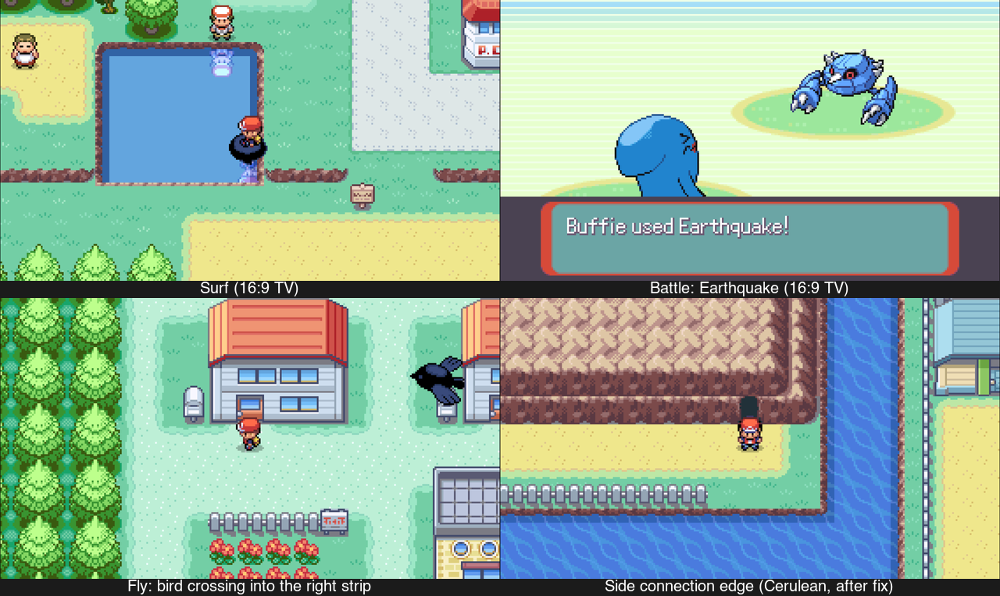

# Testing

Tested on a desktop build of Fulldex's GBA player at Steam Deck (16:10) and TV (16:9) sizes, comparing screenshots pixel by pixel. Tools are in `tests/`.

**Works**
- Walking, matching FireRed's Fulldex widescreen exactly at the sides
- 3:2 mode identical to the original game
- Doors, menus, saving and loading
- Battles, Surf, Fly
- Fog, ash, sandstorm, underwater and rain across the full width
- Map connections (Cerulean)
- Fulldex picks the built-in patch for v1.0.22 and leaves other releases alone

**Releases**

| G3E | Result |
|---|---|
| v1.0.22, v1.0.21, v1.0.15, v1.0.8 | Patched and play-tested |
| v1.0.3 | Refused (built differently) |

Not tested yet: see [ROADMAP.md](../ROADMAP.md).
